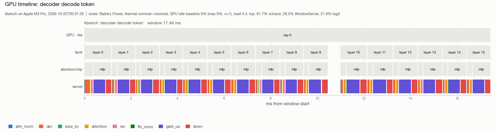
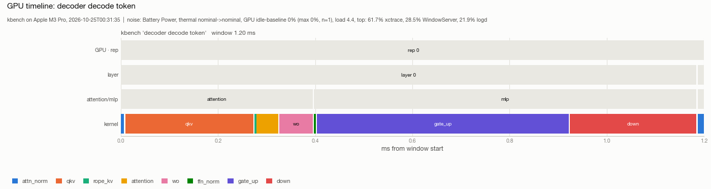
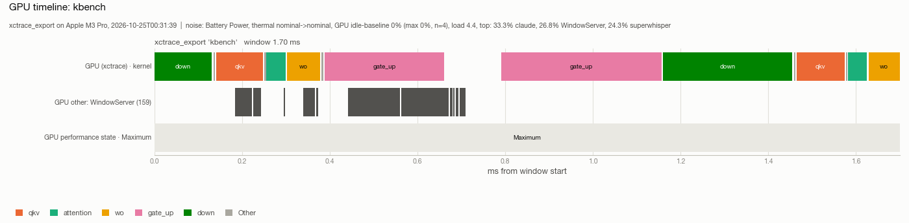
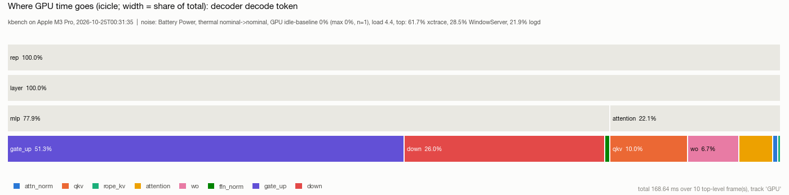
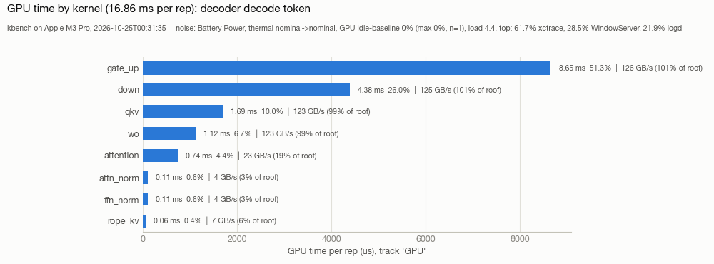
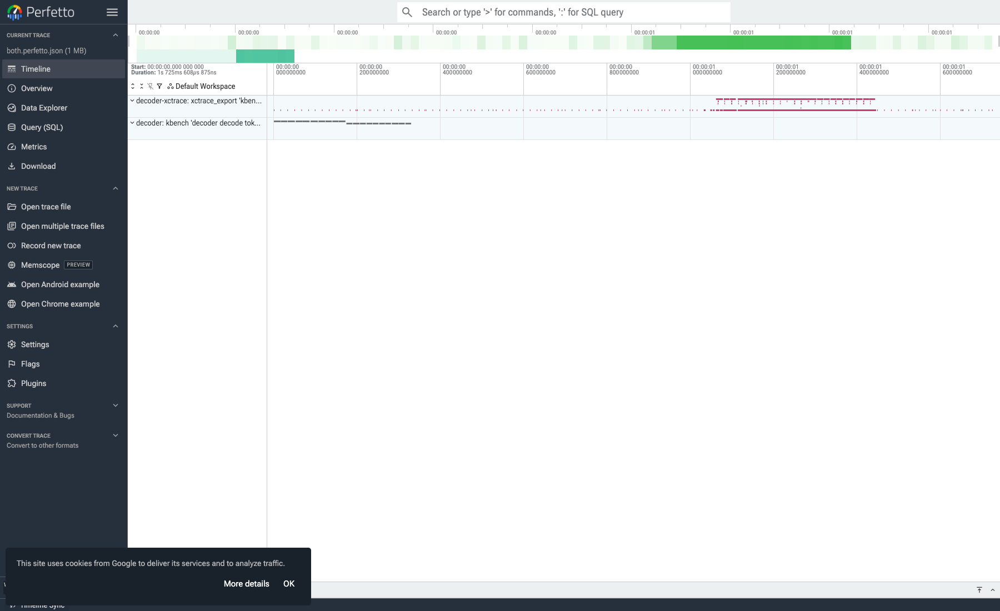

# profiling

Tools for measuring how fast Metal kernels run, ours and llama.cpp's, with reproducible numbers and the measurement noise recorded alongside them.

Run everything from `ios_kernels/`. Design, objectives, status and measured results are in
[PLAN.md](PLAN.md), and each subfolder's README says what it holds. Outputs go to
`$DATA_DIR/prof/` (`<repo>/.context/prof/` by default). Every tool writes the same `kprof/1`
JSON (see "Output format"), so any producer works with any consumer.

## Quickstart

```sh
uv run profiling/build.py                                            # Swift tools -> profiling/.build/
profiling/.build/kbench profiling/examples/roofline/bandwidth.json   # this machine's bandwidth roof
profiling/.build/kbench profiling/examples/roofline/compute.json     # ... and its FLOP/s roof
profiling/.build/kbench profiling/examples/matmul/matvec.json        # profile one kernel
profiling/.build/kbench profiling/examples/matmul/matvec.json --set M=8192 --set NR=2   # another shape / tunable
```

`kbench` prints one row per step:

| column | meaning |
|---|---|
| median / min / p90 us | GPU time per dispatch (timed encoder time divided by `repeat`) |
| spread% | (p90 − p10) / median. Above 10% the row is flagged as noisy; the median stays robust |
| GB/s, GFLOP/s | from the spec's `bytes` / `flops` per dispatch |
| %bw, %flop | against the measured roof in `$DATA_DIR/prof/peaks.json` |

The roof is the best the roofline specs have reached on this machine, not a theoretical
limit, so a well-tuned kernel can slightly exceed 100%. The table is followed by a noise line
(see "Noise") and the path of the `kprof` file.

## Single kernels: `kbench` specs

A spec describes one or more **steps** (kernel dispatches) over named **buffers**. Every size
can be an expression over `vars` and numeric `defines`:

```json
{
  "name": "matvec f16",
  "source": "matmul.metal",
  "defines": {"NR": 4, "NSG": 8},
  "vars": {"M": 4096, "K": 4096, "ROT": 4},
  "buffers": {
    "W": {"type": "half",  "count": "M * K", "init": "random", "rotate": "ROT"},
    "x": {"type": "float", "count": "K", "init": "random"},
    "y": {"type": "float", "count": "M"}
  },
  "steps": [
    {"name": "matvec", "kernel": "matvec_f16",
     "bind": [{"buf": "W"}, {"buf": "x"}, {"buf": "y"}, {"u32": "M"}, {"u32": "K"}],
     "threadgroups": ["M / (NR * NSG)"], "threads": ["32 * NSG"],
     "bytes": "M * K * 2 + K * 4 + M * 4", "flops": "2 * M * K",
     "repeat": 8}
  ],
  "warmup": 5, "reps": 30
}
```

| field | meaning |
|---|---|
| `source` | `.metal` file relative to the spec, compiled at runtime (no Metal toolchain needed). `fast_math` (default true) matches the kernels in `../kernels/` |
| `defines` | `#define NAME VALUE` lines prepended to the source. Override with `--set NAME=VALUE` |
| `vars` | named numbers or expressions (they may reference each other). Override with `--set` |
| `buffers.X.type` | `half float int uint short ushort char uchar` |
| `buffers.X.count` | element count |
| `buffers.X.init` | `zero` (default), `ones`, `random` (uniform [-1, 1)), `iota`, `{"random": [lo, hi]}`, `{"random_int": [lo, hi]}`, `{"const": v}`. Seeds are fixed, so runs are reproducible |
| `buffers.X.rotate` | N identical copies, cycled per dispatch, so consecutive dispatches don't hit in cache (real layers have distinct weights). `1` measures the cache-warm case |
| `steps[].bind` | the argument table in index order: `{"buf": name, "offset": bytes}`, a scalar `{"u32"/"i32"/"f32"/"f16"/"u16": expr}`, or `{"struct": [fields...]}` packed with MSL alignment |
| `steps[].threadgroups` + `threads` | `dispatchThreadgroups`. `grid` + `threads` uses `dispatchThreads` instead |
| `steps[].threadgroup_memory` | byte sizes, one per threadgroup-memory index |
| `steps[].bytes` / `flops` | work per dispatch, for GB/s and GFLOP/s. Count compulsory traffic: what has to move at least once |
| `steps[].repeat` | dispatches per timed encoder. Raise it for kernels under ~50 us, so encoder overhead is amortized |
| `warmup`, `reps` | untimed and timed repetitions (`--warmup`, `--reps` override them) |
| `roof` | `"bandwidth"` or `"flops"`: the spec measures the machine's roof (see "Roofline") |
| `loop` | `{"name": "layer", "count": expr}`: run the step list `count` times per rep. Use `rotate` on weight buffers so each iteration has its own copy |
| `steps[].group` | an extra nesting level for charts, e.g. `"attention"` / `"mlp"` |
| `whole` | `true`: also time each rep as **one** encoder, the way an engine encodes a token, and compare that with the sum of the split steps. The difference is what profiling costs |

Expressions support `+ - * / %`, parentheses, and `min max ceil floor round ceildiv pow log2`.
Integer contexts (counts, grids) fail loudly when a result isn't an integer.
`kbench SPEC --list` prints the resolved spec without running it.

## How timing works

- **One encoder per timed step.** Apple GPUs take timestamps only at encoder boundaries
  (`supportsCounterSampling(.atDispatchBoundary)` is false on M-series), so each step's
  dispatches go in their own encoder, with its start and end written to an
  `MTLCounterSampleBuffer`.
- **Timed encoders are chained with a fence.** Apple GPUs run *independent* encoders
  concurrently, even across command buffers. Metal only orders encoders that share
  resources. `RegionProfiler` makes every timed region wait for the previous one, so no
  region absorbs another's work.
- **Pipelined repetitions.** Each rep is its own command buffer, and they are queued back to
  back, so the GPU stays busy and clocked up.
- **Timestamps are ns** on the `CLOCK_UPTIME_RAW` clock (Apple silicon's GPU timestamps are
  already in that domain), so CPU and GPU events share one timeline.
- **Limits:** one counter sample buffer holds 2048 regions, and only about 32 can exist at
  once. `RegionProfiler.collect()` frees them.

## Roofline

`examples/roofline/` streams 512 MiB (read, copy, write) and runs `simdgroup_matrix` MMA and
FP32 FMA loops. Its specs set `roof`, so `kbench` records the best throughput in
`$DATA_DIR/prof/peaks.json`, and every later result reports a % of it. The file keeps the
best value ever measured, so a run slowed down by noise never lowers the roof.
`--reset-peaks` starts over, for example on a new machine.

## Noise

We don't require a quiet machine; every output records what was going on (`noise` in the
JSON, one summary line on stdout):

- **GPU idle baseline:** device-wide GPU busy % (IOAccelerator `PerformanceStatistics`, the
  value `ioreg -r -c IOAccelerator` shows, no sudo needed). It is sampled every 250 ms for
  `--idle-ms` (default 1000) *before* our run, which captures other processes' GPU load, and
  during the run, which includes our own work. The first read after a pause is stale, and
  polling faster than ~100 ms reads 100%, so the first sample is dropped.
- **Power source, Low Power Mode and thermal state** at start and end, the **load average**,
  and the **busiest CPU processes** at start.
- **`notes`:** plain-language warnings (on battery, thermal pressure, GPU busy before the run).

The idle baseline is measured before the run, so load that starts mid-run shows up only as
slow outliers. xctrace recordings attribute GPU time to processes (see "Systems of kernels").

## Output format: `kprof/1`

JSON with snake_case keys, defined in `lib/KProf.swift` (Swift) and `tools/kprof.py` (Python):

- `meta`: tool, name, created, device (name, model, gpu_cores, ...), os, git (`sha[-dirty]`),
  argv, spec, and params (the resolved defines and vars).
- `noise`: start/end snapshots, `gpu_util_idle` / `gpu_util_run`, and notes.
- `events`: one per timed region, with name, kernel, `stack` (the nesting path, outermost
  first, e.g. `["rep 3", "layer 7", "qkv"]`), track, start_ns, dur_ns, bytes, flops,
  variant and args. `dur_ns` covers all `repeat` dispatches of a region.
- `counters`: time series (e.g. GPU util %), one track each.
- `results`: aggregate rows, with n, median/mean/std/min/p10/p90 us per dispatch, gbps,
  gflops, pct_peak_bw, pct_peak_flops, and `method` (how the row was measured).

## llama.cpp per-op baseline: `llama_ops.py`, `compare.py`

llama.cpp's own op benchmark (`test-backend-ops perf`) times its Metal kernels one op at a
time. `tools/llama_ops.py` drives it and converts the results to `kprof`, with the noise
recorded by `knoise`:

```sh
uv run profiling/tools/llama_ops.py build              # test-backend-ops, test-export-graph-ops, llama-bench
uv run profiling/tools/llama_ops.py export --model $DATA_DIR/models/llama1b_f16.gguf --ctx 512
uv run profiling/tools/llama_ops.py mul-mat --shape 4096,1,4096 --shape 2048,512,2048
uv run profiling/tools/llama_ops.py list $DATA_DIR/prof/llama_ops/mul_mat.txt
uv run profiling/tools/llama_ops.py bench $DATA_DIR/prof/llama_ops/mul_mat.txt
uv run profiling/tools/compare.py ours.json llama.json --labels ours,llama \
    --pair "matvec=MUL_MAT mm_f16_4096x1x4096 f16 M=4096 N=1 K=4096"
```

- `build` builds the test tools from the shared llama.cpp checkout (`surfaces.paths.LLAMA_DIR`)
  into its own build directory.
- `export` writes the unique ops of the model's prompt-processing and token-generation graphs.
  `--ctx` sets the KV length of the attention ops; without it, the model's full trained
  context gets exported.
- `mul-mat` writes test cases for arbitrary MUL_MAT shapes (f16/bf16/f32 weights). It reads the
  op and type IDs from the build's `ggml.h`.
- `bench` runs `test-backend-ops perf -b MTL0 --output sql` (the CSV output omits the timing
  columns) and computes FLOPs for MUL_MAT. `--grep` filters rows, and `--op`/`--params` run
  llama.cpp's built-in perf cases instead of a test file.
- `compare.py A B` matches results by name (or `--pair` / `--map`) and prints the speedup
  together with both files' methods and noise. `--md` gives a markdown table.

**Read llama.cpp's numbers with its method in mind:**
- *Cache-warm:* it averages many back-to-back runs of one op on the same buffers. When the
  working set fits in the GPU's caches, that is faster than a real forward pass, where each
  layer's weights are cold. `kbench --set ROT=1` gives the like-for-like number; the default
  rotation gives the realistic one.
- *Whole-tensor GB/s:* its bandwidth is (sum of the tensor sizes) / time, which is
  meaningless for gathers and scatters (`GET_ROWS` from the embedding table, `SET_ROWS`
  into the KV cache). Use the time for those.
- *Launch floor:* decode-sized elementwise ops all sit at a few microseconds, which is the
  per-op cost a fused kernel removes.

### Noise around any command: `knoise`

`profiling/.build/knoise [--out PATH] [--idle-ms MS] [--name NAME] -- COMMAND ...` runs the
command and writes a `kprof` file with the same noise fields as `kbench`, a GPU-util counter
track, and one event spanning the command. `llama_ops.py bench` and `xctrace_record.py` use
it, and it works for `llama-bench`, our engine, or anything else.

## Systems of kernels

### Pipelines in `kbench`

A spec whose steps share buffers is a pipeline; `loop`, `steps[].group` and `whole` (see the
spec table) shape it. `examples/pipeline/decoder.json` is one decode token through
Llama-3.2-1B-shaped layers. Its events nest as `rep > layer i > attention|mlp > step`, and
its report ends with the whole-vs-split comparison.

### Embedding `RegionProfiler` in a Swift/Metal program

Compile `profiling/lib/*.swift` together with the program
(`swiftc ... profiling/lib/*.swift main.swift`):

```swift
let prof = RegionProfiler(device: device)            // serialize = true: regions never overlap
let cb = queue.makeCommandBuffer()!
let enc = prof.makeEncoder(cb, name: "qkv", kernel: "matvec_f16",
                           stack: ["token 0", "layer 3", "qkv"], bytes: b, flops: f)
// ... set pipeline and buffers, dispatch ...
prof.end(enc)                                        // instead of enc.endEncoding()
cb.commit(); cb.waitUntilCompleted()
let (events, invalid) = prof.collect()               // ns, CLOCK_UPTIME_RAW; resets the profiler
var k = KProf(meta: KProf.Meta(tool: "myengine", name: "decode", created: isoNow(), device: deviceMeta(device),
                                os: ProcessInfo.processInfo.operatingSystemVersionString, git: nil,
                                argv: CommandLine.arguments, spec: nil, params: nil))
k.events = events
try k.write(to: "out.json")
```

Keep an unsplit measurement of the same work next to the split one (as `kbench`'s `whole`
does), so the cost of profiling is known. Wrap the program in `knoise` to record the noise.

### Any process, including llama.cpp: xctrace

```sh
uv run profiling/tools/xctrace_record.py -- $DATA_DIR/deps/llama.cpp/build-tests/bin/llama-bench \
    -m $DATA_DIR/models/llama1b_f16.gguf -p 0 -n 16 -r 1 -ngl 99
uv run profiling/tools/xctrace_export.py $DATA_DIR/prof/xctrace/llama-bench-<time>.trace
# check our own timestamps against Instruments on the same run:
uv run profiling/tools/xctrace_record.py --out $DATA_DIR/prof/xctrace/dec.trace -- profiling/.build/kbench \
    profiling/examples/pipeline/decoder.json --out $DATA_DIR/prof/xctrace/dec.kbench.json
uv run profiling/tools/xctrace_export.py $DATA_DIR/prof/xctrace/dec.trace --validate $DATA_DIR/prof/xctrace/dec.kbench.json
```

- `xctrace_record.py` records headless with Metal System Trace (or
  `profiling/templates/kprof.tracetemplate` when it exists) under `knoise`, and checks that
  the trace is readable afterwards.
- `xctrace_export.py` writes `kprof` with:
  - the target process's GPU intervals, one per encoder, named by the encoder label
    (`RegionProfiler` labels encoders with the step name);
  - other processes' GPU work in the same window (as tracks, and summarized in
    `noise.xctrace.other_gpu_processes`);
  - GPU performance states and thermal states, and the device-wide GPU busy %;
  - encoders split by preemption.
- `--validate` compares per-encoder medians with a `kbench` file from the same run. Both read
  the GPU's encoder timestamps, so medians agree. Means can differ for preempted encoders:
  our span includes the preempted time, while xctrace sums only the active pieces.
- With the stock template, granularity is one interval per encoder. That's per kernel for
  `RegionProfiler` users. For llama.cpp, whose encoders are unlabeled and hold many ops,
  it's a fraction of a token. Per-kernel llama.cpp timelines need the shader timeline
  (PLAN.md, objective 4).

## Charts: `kviz.py`

```sh
K=profiling/tools/kviz.py
uv run --extra profiling $K gantt RUN.json                          # timeline PNG (rep 0 by default)
uv run --extra profiling $K gantt RUN.json --start-ms 0 --end-ms 1.2 # zoom (ms from the first GPU event)
uv run --extra profiling $K flame RUN.json                          # aggregate icicle / flame graph PNG
uv run --extra profiling $K share RUN.json                          # GPU time per kernel, one bar each
uv run $K perfetto RUN.json OTHER.json --open                       # interactive timeline in ui.perfetto.dev
uv run $K folded RUN.json                                           # folded stacks for speedscope.app
uv run $K table RUN.json --md                                       # the results as a table
```

| view | example |
|---|---|
| `gantt`: nesting rows (rep > layer > group > kernel), one color per kernel |  |
| `gantt` zoomed into one layer |  |
| `gantt` of an xctrace export: another process's GPU work interleaved with ours |  |
| `flame`: where the time goes, aggregated over reps and layers |  |
| `share`: GPU time per kernel with GB/s and % of roof |  |
| `perfetto`: the same events in ui.perfetto.dev |  |

- Kernels get colors from a fixed 8-slot palette, validated for color-vision deficiency, in
  order of first appearance in the file. Past 8 kernels, the smallest fold into "Other".
  Zooming never recolors a kernel. Render several files in one `gantt` call when their
  colors must match.
- `perfetto` writes the Chrome Trace Event format: one process per input file, one thread per
  track, nested slices from `stack`, and counters as counter tracks. Flat tracks with
  overlapping slices are split into lanes, because Perfetto drops partially overlapping
  slices on one thread. `--open` serves the file once on 127.0.0.1:9001 and opens
  ui.perfetto.dev on it (the trace is processed in the browser; Chrome may ask to allow
  local network access). Without `--open`, drag the file onto ui.perfetto.dev.
- `folded` aggregates `stack` paths (`layer 7` -> `layer` unless `--keep-indices`) into
  `a;b;c <ns>` lines for speedscope or `flamegraph.pl`.
- PNG commands need matplotlib (the `profiling` extra) and take `--dark` for the dark palette.
